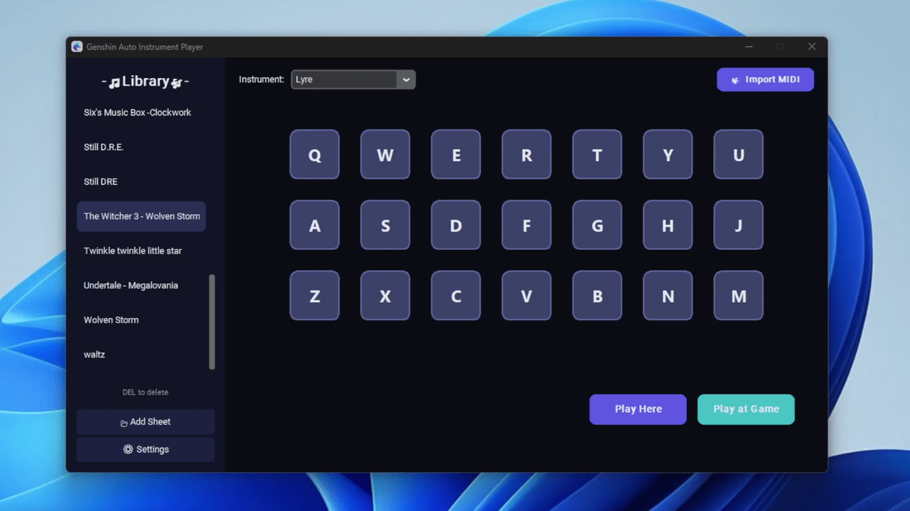

# 🎵 Genshin Auto Instrument Player

Play music automatically in **Genshin Impact** using sheet files or MIDI files!

<p align="center">
  
</p>

---

## ✨ Features

- 🎹 21-key Genshin Instrument interface  
- 🎵 Support for multiple instruments (Lyre, Zither, etc.)  
- 🎼 **MIDI import** with auto transpose and smart handling of sharps (the instrument only has white keys)  
- 📂 Easy sheet file management  
- 🎮 Play in-game or locally  
- 🛑 Stop playback anytime with `ESC` (or `"`), even while the game is in front  
- 📜 Supports multiple sheet formats  
- 🔔 Tells you when a new version is available  

---

## 📥 Installation

> **Requires Windows 10 / 11.**

### Option 1: Executable (Easiest)

1. Download `GenshinAutoPlayer.exe` from the [**latest release**](https://github.com/MERT-CKR/Genshin-AutoLyrePlayer/releases/latest)  
2. Run as **Administrator**  
3. Done!

#### Why administrator privileges?

Because **Genshin Impact runs with administrator privileges**, an application without admin rights cannot interact with it.

#### Windows SmartScreen or antivirus warning?

The exe is not code-signed yet, so Windows may show "Windows protected your PC". Click **More info → Run anyway**.

Apps that simulate key presses are sometimes flagged by heuristic antivirus scanners. This is a false positive; the source code is fully open, and the release page lists the file's SHA256 and VirusTotal report so you can check it yourself. If you prefer, run it from source (Option 2).

---

### Option 2: Python (For Developers)

1. Install Python 3.8+  
2. Clone this repository  
3. Install dependencies:

```bash
pip install -r requirements.txt
```

4. Run:

```bash
python main.py
```

---

## 🎮 How to Use

1. **Select Instrument** – Choose from the dropdown  
2. **Add Sheet** – Click "Add Sheet" or "Import MIDI"  
3. **Select Music** – Click on a song  
4. **Play** – Choose "Play Here" or "Play at Game"

### ⏯️ Play at Game

- Set the target window once: **Settings → Key Bindings → Select Game Window**  
- Open your instrument in Genshin Impact and keep the game window focused  
- Press **Play at Game**  
- Press `ESC` or `"` to stop (works from any window)  
- If the game loses focus, playback pauses and continues when you return

---

## 🎼 Importing MIDI

1. Click **Import MIDI** and pick one or more `.mid` / `.midi` files  
2. Choose the channels you want (drums are off by default). Press ▶ to listen to a channel on its own  
3. Leave **Auto transpose** on, or set the semitones yourself  
4. Keep **Smart-snap sharps** on: notes that fall on a black key are moved to the better neighbouring white key  
5. Press **Add to Library** (or **Export File…** to save a sheet file somewhere else)

---

## 📝 Sheet Format

The application supports:

- `notes` structure  
- `columns` structure  
- `songNotes` structure (Sky sheets)  
- `midi/mid` files (converted on import)

It uses the same note system as:

👉 [Genshin Music Nightly](https://specy.github.io/genshinMusic/)

You can create music there and play it directly in this app or in-game.

---

## 🎵 Where to Find Ready-Made Sheet Music

- Discord Channel: [Sky & Genshin Music Nightly](https://discord.gg/Arsf65YYHq)  
- Search in Discord communities for sheets

---

## 📂 Adding Sheets

Use **Add Sheet** or **Import MIDI**. Supported file extensions:

- `.txt`  
- `.json`  
- `.genshinsheet`  
- `.skysheet`  
- `.midi`  
- `.mid`  

---

## 📁 Managing Sheets

- **Quick access:** Settings → "📂 Open Sheets Folder"  
- **Manual access:** Win + R → type `%appdata%` → go to `GenshinAutoPlayer\sheets`  
- Select a song and press `Delete` to remove it, or rename the files freely  
- If there are no sheets, simply add your own

---

## 📜 License

Apache License Version 2.0

---

## 🙏 Credits

- Made by **Mert Çakır**  
- Uses **CustomTkinter**, **Pygame**, **PyAutoGUI** and **mido**

---

## Didn't find what you were looking for?

We're here to help. Here's how you can reach us:  

- **🐛 Report an issue**  
  If you're using **GitHub**, feel free to open an issue in the relevant repository.  
  We'll take a look as soon as possible.

- **💬 Ask the developer on Discord**  
  For faster feedback or direct support, you can reach me on Discord: **`luvica0`**

---

> Your feedback matters — don't hesitate to get in touch!
